# European Small & Mid Cap Event-Driven News Trading Bot (v1.5)


-orange.svg)

Sistema asincrono ed *event-driven* scritto in Python per l'acquisizione in tempo reale, l'estrazione full-text, il filtraggio lessicale a latenza sub-millisecondo e la valutazione quantitativa tramite Large Language Models (LLM) locali di notizie finanziarie *price-sensitive* sulle società **Small e Mid Cap quotate sui mercati europei**.

> **Nota sull'origine del progetto:** Questo software nasce come progetto indipendente sviluppato da uno studente di Ingegneria Informatica con il duplice obiettivo di approfondire sul campo gli aspetti avanzati di Python (programmazione concorrente `asyncio`, binding C ad alte prestazioni, ingegneria dei dati, architettura di sistemi resilienti) e applicarli alla microstruttura reale dei mercati azionari europei.

---

## Indice

1. [Visione Finale del Progetto e Stato Attuale dei Lavori](#1-visione-finale-del-progetto-e-stato-attuale-dei-lavori)
2. [Filosofia Architetturale: "Speed-First" e Scarto Economico su LLM](#2-filosofia-architetturale-speed-first-e-scarto-economico-su-llm)
3. [Architettura del Sistema e Diagramma del Flusso Dati](#3-architettura-del-sistema-e-diagramma-del-flusso-dati)
4. [Scelte Implementative, Microstruttura Europea e Stack Tecnologico](#4-scelte-implementative-microstruttura-europea-e-stack-tecnologico)
5. [Sfide Ingegneristiche Reali Affrontate nei Live Test (v1.1 -> v1.5)](#5-sfide-ingegneristiche-reali-affrontate-nei-live-test-v11---v15)
6. [Struttura del Repository e Schema del Database SQLite WAL](#6-struttura-del-repository-e-schema-del-database-sqlite-wal)
7. [Installazione, Guida all'Uso e Riferimento Comandi CLI](#7-installazione-guida-alluso-e-riferimento-comandi-cli)
8. [Cosa Aspettarsi come Output (Esempi Reali)](#8-cosa-aspettarsi-come-output-esempi-reali)
9. [Suite di Test e Validazione (Unit Test & Torture Test)](#9-suite-di-test-e-validazione-unit-test--torture-test)
10. [Roadmap Futura (Fase 3)](#10-roadmap-futura-fase-3)

---

## 1. Visione Finale del Progetto e Stato Attuale dei Lavori

### La Visione Finale (End-to-End Quantitative Trading System)
L'obiettivo finale del progetto è realizzare un sistema autonomo composto da **tre macro-fasi**:
1. **Fase 1 — Ingestione, Disambiguazione, Estrazione Web e Prompt Engineering (CPU-Bound):** Monitoraggio continuo di decine di fonti finanziarie europee, pulizia del testo, riconoscimento istantaneo dei ticker coinvolti, classificazione per priorità e costruzione di un prompt finanziario contestualizzato.
2. **Fase 2 — Inferenza Quantitativa Locale con LLM / Fallback Euristico (GPU-Bound):** Analisi semantica del comunicato tramite un modello LLM eseguito localmente (via *Ollama* / *vLLM*) vincolato a uno schema JSON rigoroso per stimare sentiment, confidenza, orizzonte temporale e azione operativa (`BUY_LIMIT_INTRADAY`, `BUY_LIMIT_PREMARKET`, `HOLD`, `SCALE_DOWN`, `LIQUIDATE`, `IGNORE_NOISE`).
3. **Fase 3 — Esecuzione Automatica degli Ordini e Risk Management (Broker Execution):** Connessione via API a un broker (es. Interactive Brokers / Directa) per la verifica in tempo reale del book di negoziazione (spread bid-ask, profondità), il dimensionamento della posizione e l'invio automatico di ordini limite a mercato.

### Stato Attuale del Repository (Versione Parziale v1.5)
**Questa release rappresenta uno stato intermedio e parziale del progetto:**
* **Completato e operativo al 100%:** L'intera **Fase 1** (ingestione da 40+ feed RSS/Atom, decodifica asincrona dei link Google News, estrazione full-text delle pagine web, motore di matching e tassonomia multilingua, deduplicazione cross-lingua e generazione dei prompt nella tabella `prepared_prompts`) e l'infrastruttura di **Fase 2** (`LocalLLMClient` per Ollama con validazione Pydantic v2 e motore di fallback euristico deterministico quando la GPU è spenta).
* **Non ancora implementato:** La **Fase 3** (collegamento alle API del broker, lettura live del book ordini e compravendita effettiva dei titoli) e il fine-tuning dei pesi decisionali del modello LLM su storico prezzi intraday. Attualmente il bot si ferma alla generazione dei prompt pronti per l'LLM (`READY_FOR_LLM`) e alla loro valutazione strutturata nel database locale (`llm_evaluations`).

---

## 2. Filosofia Architetturale: "Speed-First" e Scarto Economico su LLM

Nel trading *event-driven* sulle Small e Mid Cap europee (dove la copertura algoritmica istituzionale è inferiore rispetto alle Large Cap americane del S&P 500), il fattore critico è la **latenza tra la pubblicazione del comunicato primario e la comprensione del catalizzatore**.

Durante la progettazione si è presentata una scelta architetturale fondamentale:
* *Approccio A (Pre-filtraggio NLP pesante su CPU):* Utilizzare modelli linguistici pesanti (es. BERT multilingua o grandi grafi di conoscenza) già in fase di ingestione per eliminare ogni possibile ambiguità prima di preparare il prompt. Questo approccio introduce però colli di bottiglia computazionali su CPU quando arrivano centinaia di articoli contemporaneamente e rischia di generare **Falsi Negativi** (scartare per errore una vera OPA o un profit warning scritto con una formulazione insolita).
* *Approccio B (Il mio approccio — "Speed-First" + LLM Coherence Short-Circuit):* Massimizzare la velocità di ingestione e classificazione su CPU (**latenza `< 0.2 ms` ad articolo**) usando algoritmi deterministici in C (`flashtext` + lookup RegEx $O(1)$ + guardie lessicali strutturali), accettando consapevolmente che una piccola frazione di falsi positivi complessi (es. omonimie sottili) possa superare il filtro CPU ed essere scartata direttamente dall'LLM a costo ridotto.

Per rendere questo scarto su GPU quasi istantaneo, nella v1.5 è stato introdotto nel System Prompt lo **`STEP 0: MANDATORY ENTITY & SECTOR COHERENCE GATE (FAST SHORT-CIRCUIT)`**:
* Poiché nei modelli LLM la fase lenta non è la lettura del prompt (*prefill*), bensì la generazione sequenziale dei token di risposta (*decoding*), il prompt fornisce all'LLM il nome esatto della società europea e il suo settore industriale (`Sector`).
* Se l'LLM rileva che l'articolo non riguarda quella specifica società quotata ma un omonimo, interrompe immediatamente l'analisi restituendo una lista `impacted_assets: []` vuota e il tag `[ERRORE_COERENZA_ENTITA]`, tagliando del **70% il tempo di generazione GPU** sui falsi positivi residui.

---

## 3. Architettura del Sistema e Diagramma del Flusso Dati

Il sistema adotta un pattern asincrono **Producer -> PriorityQueue -> Consumer -> Event-Driven LLM Worker** orchestrato da `main.py` su un database SQLite in modalità WAL:

```mermaid
flowchart TD
    subgraph INGESTIONE["1. INGESTIONE ASINCRONA & ANTI-BAN"]
        A["40 Feed RSS/Atom Europei (eu_news_sources.txt)<br/>+ Feed Dinamici Portafoglio"] --> B["RSSPoller (ingestion/rss_poller.py)<br/>- CurlAsyncSession Chrome 120 TLS Keep-Alive<br/>- Conditional GET (ETag / Last-Modified)<br/>- Jitter ±15%, Semaphore(8) & Circuit Breaker<br/>- Filtro TTL 4h & LRUDeduplicator (15.000 hash)"]
        B --> C["Text Cleaner Preliminare (ingestion/text_cleaner.py)<br/>- Parser C-Level Lexbor (selectolax)<br/>- Strip Boilerplate & Anti-Duplicazione Titolo/Summary"]
    end

    subgraph FILTRAGGIO["2. DISAMBIGUAZIONE SUB-MILLISECONDO & GUARDIE GLOBALI"]
        C --> D1{"Stadio 0: PASSIVE_NOISE_PATTERNS<br/>(Form 8.3, SEO, Pre-Conti, Betting, Quote Statiche)"}
        D1 -- "Match Rumore (No Rule 2.7)" --> SCARTO_NOISE["Scarto Immediato O(1)"]
        D1 -- "Articolo Valido" --> D2["Stadio 1 & 2: RegexEngine (filtering/regex_engine.py)<br/>- FlashText O(N) Pre-screening<br/>- Lookup O(1) per Ticker (_rules_by_ticker)<br/>- Guardie Nomi Corti, Consorzi, Acronimi USA e Broker"]
        D2 --> E["TaxonomyClassifier (filtering/taxonomy_classifier.py)<br/>- Scoring Ponderato Multilingua (EN/IT/DE/FR/ES)<br/>- Compilatore Morfologico Tedesco (\b\w*?radice\w*?\b)<br/>- Mascheramento B2B, Guardie CdA, Webcast e PNC Consob"]
    end

    subgraph FULLTEXT["3. ESTRAZIONE WEB FULL-TEXT & PROGRESSIVE CROPPING"]
        E --> F1{"Summary < 1.200 char<br/>AND Priorità <= MAX_LLM_PRIORITY?"}
        F1 -- "SI" --> F2["ArticleExtractor (ingestion/article_extractor.py)<br/>- Risoluzione Asincrona Google News RPC (batchexecute + SOCS)<br/>- Estrazione HTML Lexbor (<article>, <p>, .news-text)"]
        F1 -- "NO" --> F3["Mantiene Contesto RSS"]
        F2 --> F4["Progressive Budget Cropping fino a 8.000 char<br/>& Riclassificazione Tassonomica sul Testo Completo"]
        F3 --> F4
    end

    subgraph ORCHESTRAZIONE["4. CODA PRIORITARIA, DEDUP 45M & PROMPT BUILDER"]
        F4 --> G1["asyncio.PriorityQueue<br/>(priority_level, next(itertools.count()), item)"]
        G1 --> G2["Consumer Worker & Archiviazione in news_archive"]
        G2 --> G3{"Priority Gate (Prio <= 2)<br/>& Dedup Cross-Lingua 45m?"}
        G3 -- "Prio 3 (General / Analyst)" --> H2["Archiviazione Silente in DB<br/>(Risparmio 70-80% chiamate GPU)"]
        G3 -- "Duplicato con Contesto >= 2x" --> G_UP["Context Upgrade In-Place<br/>(Aggiorna prompt READY_FOR_LLM)"]
        G3 -- "Nuovo Catalizzatore Prio 1-2" --> I1["PromptBuilder (prompt_builder/builder.py)<br/>- Fasi Mercato CET/CEST, Guardrail Liquidità Small Cap<br/>- Salvataggio in prepared_prompts + asyncio.Event.set()"]
    end

    subgraph INFERENZA["5. INFERENZA LLM LOCALE & STEP 0 SHORT-CIRCUIT"]
        I1 -- "Wake-up < 0.05ms" --> K1["LocalLLMClient (llm/local_client.py)<br/>- Ollama / vLLM (keep_alive: -1, JSON Schema grammar)<br/>- STEP 0: Entity & Sector Coherence Short-Circuit<br/>- Fallback Euristico Deterministico se GPU offline"]
        K1 --> L1[("Tabella llm_evaluations<br/>Output Validato Pydantic v2")]
    end
```



---

## 4. Scelte Implementative, Microstruttura Europea e Stack Tecnologico

Ogni libreria esterna e ogni modulo del bot rispondono a un preciso vincolo tecnico o di microstruttura finanziaria:

### 4.1 Stack Tecnologico e Librerie C-Backed
* **`curl_cffi` (`CurlAsyncSession(impersonate="chrome120")`):** Molti portali finanziari e proxy RSS utilizzano WAF (Cloudflare, Akamai) che bloccano le librerie HTTP Python standard (`requests`, `aiohttp`, `urllib3`) ispezionando il **TLS Fingerprint (JA3/JA4)** durante l'handshake SSL, prima ancora di leggere l'header `User-Agent`. `curl_cffi` utilizza i binding a `curl-impersonate` per replicare a basso livello la firma crittografica e HTTP/2 di Google Chrome 120, prevenendo i blocchi `403 Forbidden`. Il poller mantiene una sessione persistente con fallback automatico su `aiohttp`.
* **`selectolax` (`selectolax.lexbor.LexborHTMLParser`):** Per estrarre il testo da pagine HTML che pesano 80–150 KB senza rallentare l'event loop, `BeautifulSoup` (in puro Python) è troppo lento. `selectolax` incapsula il motore C **Lexbor**, permettendo la rimozione dei nodi di disturbo (`script`, `style`, `nav`, `footer`, cookie banner) e la selezione CSS in frazioni di millisecondo.
* **`flashtext` (`KeywordProcessor`) + Indicizzazione RegEx $O(1)$:** Valutare sequenzialmente **2.224 espressioni regolari** su ogni articolo in ingresso richiederebbe milioni di operazioni per ciclo di polling. Il nostro `RegexEngine` (`filtering/regex_engine.py`) opera in **due stadi**:
  1. *Stadio 1 ($O(N)$):* L'automa a trie di Aho-Corasick (`flashtext`) scansiona il testo una sola volta ed estrae in tempo lineare rispetto alla lunghezza dell'articolo solo i `candidate_tickers` presenti.
  2. *Stadio 2 ($O(1)$):* Il motore accede tramite dizionario (`self._rules_by_ticker[ticker]`) **esclusivamente** alle 3–4 regole RegEx dei ticker candidati, abbattendo del **99,8%** le valutazioni RegEx.
* **`pydantic` (v2):** Utilizzato sia per validare i modelli interni (`RawNewsItem`, `FilteredNewsItem`, `PreparedPromptPayload`) sia per generare tramite `TargetLLMResponseSchema.model_json_schema()` la grammatica formale JSON passata al parametro `"format"` di Ollama.
* **SQLite 3 in modalità `WAL` (`Write-Ahead Logging`):** Gestito da `database/db_manager.py` con connessioni `threading.local()` e lock di scrittura, consente al `producer`, al `consumer` e all'`llm_worker` (oltre a DataGrip/PyCharm dall'esterno) di leggere e scrivere simultaneamente senza errori `database is locked`.

### 4.2 Adattamento alla Microstruttura delle Small & Mid Cap Europee
* **Universo Multilingua e Multi-Valuta (644 Società, 13 Mercati, 5 Lingue):** Il file `eu_small_mid_caps.txt` censisce 644 società distribuite su Italia (`IT_MID`, `IT_STAR`, `IT_SMALL`), Germania (`DE_MDAX`, `DE_SDAX`), Francia (`FR_MID`, `FR_SMALL`), Regno Unito (`UK_FTSE250`), Paesi Bassi, Belgio, Spagna, Svizzera, Austria e Paesi Nordici (Svezia, Danimarca, Finlandia, Norvegia). I dizionari riconoscono nativamente Inglese, Italiano, Tedesco, Francese e Spagnolo e tutte le valute/unità locali (`EUR`, `GBP`, `pence`, `CHF`, `SEK`, `NOK`, `DKK`, `MEUR`, `MSEK`, `Mio.`, `Mrd.`).
* **Protezione dallo Slippage (`SMALL_CAP_LIQUIDITY_GUARDRAIL`):** I titoli quotati su segmenti come Euronext STAR, XETRA SDAX o Small Cap presentano book sottili e spread denaro-lettera ampi. `prompt_builder/builder.py` inietta automaticamente il guardrail di liquidità per questi indici, vietando l'azione `BUY_MARKET` e imponendo ordini limite (`BUY_LIMIT_INTRADAY` o `BUY_LIMIT_PREMARKET`).
* **Consapevolezza Dinamica delle Sessioni di Borsa Europee (`Europe/Rome`):** In Europa oltre il 70% dei comunicati price-sensitive esce a mercati chiusi (`07:00–09:00 CET` o `17:35–20:00 CET`). `format_market_context()` calcola l'orario CET/CEST corrente e distingue 6 fasi (`PRE_MARKET_AUCTION`, `OPENING_VOLATILITY_WINDOW`, `CONTINUOUS_TRADING`, `CLOSING_AUCTION`, `AFTER_HOURS_CLOSED`, `WEEKEND_CLOSED`), orientando i segnali pre-apertura verso l'asta delle 09:00 (`BUY_LIMIT_PREMARKET`).
* **Guardrail contro "Chasing the Spike", ABB e Buyback di Routine:** Il builder rileva tramite regex se l'articolo commenta un rialzo/sospensione già avvenuto (`[MARKET_REACTION_IN_PROGRESS]`), se riguarda un collocamento accelerato diluitivo (`[DILUTION_OR_ABB_WARNING]`) o se è il riepilogo settimanale obbligatorio sugli acquisti di azioni proprie già effettuati (`[ROUTINE_BUYBACK_DISCLOSURE]`).

---

## 5. Sfide Ingegneristiche Reali Affrontate nei Live Test (v1.1 -> v1.5)

Uno degli aspetti più formativi dello sviluppo è stato sottoporre il bot a sessioni ripetute di test sul web reale (da 30 minuti, 60 minuti e 2 ore), analizzando i database generati e risolvendo i problemi con **soluzioni strutturali generalizzate** anziché con "cerotti" ad-hoc:

### 1. Il Problema dei Contesti Corti (< 200 char), i Token Opachi di Google News e il Muro GDPR
* **Difficoltà:** Nei primi test live, la lunghezza media del contesto nei prompt era di soli **146–172 caratteri** (contro un budget di 6.000 caratteri). L'analisi ha rivelato tre cause:
  1. I feed RSS di Google News non includono l'articolo nel tag `<description>`, ma ripetono il titolo seguito dal nome della testata (causando una doppia ripetizione del titolo nel prompt).
  2. Da luglio 2024 Google News non codifica più l'URL dell'editore in Base64 nel path (`CBMi...`), ma usa un token opaco e reindirizza gli IP europei alla pagina di consenso cookie `consent.google.com`.
  3. Nelle versioni recenti di `selectolax`, il sottomodulo `selectolax.parser` era stato deprecato in favore di `selectolax.lexbor`, facendo fallire silenziosamente l'import.
* **Soluzione implementata:**
  * Creato il modulo asincrono `ingestion/article_extractor.py` basato su `selectolax.lexbor`.
  * Senza usare librerie sincrone esterne (che avrebbero bloccato l'event loop `asyncio`), abbiamo implementato direttamente dentro la sessione `curl_cffi` Chrome 120 l'iniezione del cookie `SOCS` (per scavalcare il muro GDPR di Google) e la chiamata `POST` all'endpoint RPC interno di Google `/_/DotsSplashUi/data/batchexecute?rpcids=Fbv4je` (estraendo `data-n-a-sg` e `data-n-a-ts` dalla splash page) per decodificare l'URL reale dell'editore in ~250 ms.
  * Sostituito il vecchio ritaglio fisso a `±2` frasi in `crop_context()` (che causava un "effetto gradino" facendo collassare comunicati da 10.000 caratteri a 400 caratteri) con un algoritmo di **Progressive Budget Expansion**, che espande dinamicamente il raggio delle frasi attorno ai match fino a riempire effettivamente il budget di **6.000 caratteri**. Nei test successivi (v1.4 e v1.5), la lunghezza media dei contesti operativi è salita a **oltre 3.070 caratteri** (con picchi di 5.835 caratteri).

### 2. Crash di Concorrenza su Windows nella `asyncio.PriorityQueue`
* **Difficoltà:** Durante il primo ciclo di polling (oltre 430 articoli elaborati in pochi millisecondi), il bot è andato in crash con `TypeError: '<' not supported between instances of 'FilteredNewsItem' and 'FilteredNewsItem'`.
* **Causa e Soluzione:** La tupla inserita nella coda prioritaria era `(priority_level, time.monotonic(), filtered_item)`. Su Windows il timer `time.monotonic()` ha una granularità tale per cui due articoli filtrati nello stesso millisecondo ricevevano lo stesso identico `float`; a parità dei primi due elementi, `heapq` tentava di confrontare il terzo elemento (`FilteredNewsItem`). Abbiamo sostituito `time.monotonic()` con un contatore atomico strettamente crescente `itertools.count()` (`next(self._queue_counter)`), garantendo l'unicità matematica del secondo elemento della tupla e l'ordine FIFO.

### 3. Collisioni con Ticker USA, Parole Comuni del Dizionario ed Enti Non-Profit
* **Difficoltà:** Sui feed internazionali sono emersi casi limite insidiosi:
  * *Flash résultats (PHM) : PulteGroup, Inc.* (colosso edilizio USA quotato al NYSE come `PHM`) agganciava la spagnola *PharmaMar* (`PHM.MC`).
  * Un comunicato sanitario USA contenente l'espressione minuscola *"frontline teams"* agganciava la compagnia di petroliere norvegese *Frontline* (`FRO.OL`).
  * Un articolo HR contenente *"Workplace Disruption"* agganciava *International Workplace Group* (`IWG.L`) perché la rimozione dei suffissi `International` e `Group` lasciava la sola parola `"Workplace"`.
  * Un articolo del Sole 24 Ore sul *Consorzio ELIS* di Roma agganciava la multinazionale francese *Elis SA* (`ELIS.PA`).
  * Un comunicato di J.P. Morgan sul lancio del fondo `'My OnChain Net Yield Fund ("MONY")'` agganciava la britannica *Mony Group* (`MONY.L`).
* **Soluzione strutturale:**
  1. Riformata la regola `EXPLICIT_SYMBOL` in `database/seeder.py`: rimosso il match cieco sui simboli tra parentesi `(SYM)`, richiedendo obbligatoriamente un prefisso di borsa europeo esplicito (`BIT:IP`, `BME:PHM`, `XETRA:LHA`).
  2. Audit completo delle 644 società in watchlist: tutti i nomi aziendali che coincidono con parole comuni del dizionario (`COMMON_NAME_WORDS` / `STRICT_DICTIONARY_COMPANY_NAMES`) sono ora compilati con **`is_case_sensitive = 1`** (iniziale maiuscola obbligatoria) e richiedono la presenza di `HARD_FINANCIAL_CONTEXT_WORDS` (termini strettamente azionari/di borsa).
  3. Aggiunte guardie contestuali nel `RegexEngine` per scartare enti non societari (`Consorzio`, `Fondazione`, `Istituto`, `Associazione`) e acronimi ridefiniti nel testo per fondi USA o token crypto (`_is_redefined_third_party_acronym`).

### 4. Disambiguazione del Ruolo di "Broker / Casa d'Investimento"
* **Difficoltà:** Società quotate presenti nella nostra watchlist come *Equita Group* (`EQUI.MI`), *Mediobanca* (`MB.MI`), *DWS Group* (`DWS.DE`) o *TP ICAP* (`TCAP.L`) pubblicano quotidianamente decine di giudizi e target price su altre azioni (es. *"Diasorin, Equita alza il target price a 90 euro"*, *"Moncler, Equita abbassa target price"*). Il bot agganciava il ticker del broker come se la notizia riguardasse il bilancio del broker stesso.
* **Soluzione strutturale:** Censiti in `FINANCIAL_INTERMEDIARY_TICKERS` tutti i **26 broker, banche d'affari e asset manager** della watchlist. Quando uno di questi ticker compare insieme a pattern di emissione rating (`ANALYST_ISSUER_ACTION_PATTERNS`) o nella struttura sintattica `<Altra Società>, <Broker> ...` senza indicatori di governance propria (`CdA di Equita`, `bilancio di Equita`), il ticker del broker viene rimosso dai match.

### 5. Parole Composte Tedesche, Deduplicazione Cross-Lingua e "Context Upgrade"
* **Difficoltà:**
  1. In tedesco i concetti finanziari si fondono in parole composte senza spazi: il Profit Warning di Krones (*"Krones senkt **Umsatzprognose**"* = *Umsatz* + *Prognose*) e il via libera Antitrust di Hornbach (*"**Kartellamtsentscheid**"* = *Kartellamt* + *Entscheid*) non venivano riconosciuti dalle regex con confini di parola rigidi `\bprognose\b` e `\bkartellamt\b`.
  2. Le multinazionali europee (*Ipsen*, *Nexans*, *Maisons du Monde*, *Nexity*) pubblicano i comunicati simultaneamente in inglese e in francese/tedesco: l'indice di Jaccard sui titoli tra lingue diverse è prossimo a zero, generando prompt duplicati.
* **Soluzione strutturale:**
  1. Introdotto in `filtering/taxonomy_classifier.py` un **compilatore morfologico a doppia modalità**: i termini corti ($< 6$ lettere come `opa`, `ema`, `fy`) mantengono i confini rigidi `\bkw\b`, mentre le radici polisillabiche tedesche (`_GERMAN_COMPOUND_ROOTS`: `prognose`, `umsatz`, `kartellamt`, `übernahme`, `gewinnwarnung`, ecc.) vengono compilate con `\b\w*?radice\w*?\b`, intercettando qualsiasi parola composta in $O(1)$.
  2. Estesa la finestra di deduplicazione a **45 minuti** e affiancato a Jaccard l'estrattore di **Impronta Numerica (`_extract_numeric_tokens`)**: se due notizie sullo stesso ticker e categoria condividono le medesime cifre chiave (es. `-10.9%`, `176.3`, `21.4%`), vengono riconosciute come lo stesso evento anche se scritte in lingue diverse.
  3. Aggiunto il meccanismo di **Context Upgrade In-Place**: se arriva prima un lancio d'agenzia corto (es. 150 caratteri) e pochi minuti dopo arriva il comunicato integrale da 5.000 caratteri mentre il prompt è ancora in stato `READY_FOR_LLM`, il bot aggiorna il prompt esistente con il testo ricco anziché scartarlo.

---

## 6. Struttura del Repository e Schema del Database SQLite WAL

```text
trading_bot/
├── eu_news_sources.txt               # 40 sorgenti RSS/Atom (PR Wires, Editoriali, Google News Proxies)
├── eu_small_mid_caps.txt             # Anagrafica di 644 società Small & Mid Cap europee
├── main.py                           # Orchestratore asincrono (Producer-Consumer-LLMWorker) e CLI
├── requirements.txt                  # Dipendenze Python del progetto
├── run_torture_test.py               # Runner di stress test su 16 scenari estremi di microstruttura
├── torture_test_news.json            # Dataset JSON dei 16 casi limite del Torture Test
├── config/
│   └── settings.py                   # Costanti globali, dizionari multilingua, pattern anti-rumore
├── database/
│   ├── db_manager.py                 # Singleton thread-safe SQLite3 in modalità WAL
│   ├── schema.sql                    # DDL delle 6 tabelle e dei 14 indici B-Tree
│   └── seeder.py                     # Parser dei file TXT e generatore delle 2.224 regole RegEx
├── filtering/
│   ├── regex_engine.py               # Motore a 2 stadi (FlashText O(N) + RegEx O(1) + Guardie v1.5)
│   └── taxonomy_classifier.py        # Classificatore ponderato multilingua e morfologia tedesca
├── ingestion/
│   ├── article_extractor.py          # Estrattore full-text (Lexbor + Google News RPC batchexecute)
│   ├── rss_poller.py                 # Poller asincrono con curl_cffi Chrome 120, ETag e Circuit Breaker
│   └── text_cleaner.py               # Pulizia HTML, anti-duplicazione titolo e Progressive Cropping 6k
├── llm/
│   └── local_client.py               # Client asincrono Ollama/vLLM + Fallback Euristico deterministico
├── models/
│   └── schemas.py                    # Modelli Pydantic v2 e JSON Schema per output strutturato LLM
├── prompt_builder/
│   ├── builder.py                    # Assemblaggio prompt con latenza e guardrail microstruttura
│   └── templates.py                  # System Prompt (con Step 0 Short-Circuit) e sessioni CET/CEST
└── tests/
    └── test_pipeline.py              # Suite di 83 test unitari e di integrazione (pytest)
```

Il database SQLite (`trading_bot.db`) è strutturato su **6 tabelle relazionali**:
1. `watchlist`: Anagrafica delle 644 società (`ticker`, `base_symbol`, `company_name`, `clean_name`, `sector`, `index_country`, stato portafoglio).
2. `keywords`: Le 2.224 regole RegEx pre-compilabili generate dal seeder con flag `is_case_sensitive` e `requires_financial_context`.
3. `news_sources`: Stato operativo dei 40 feed RSS (`last_polled_at`, `last_etag`, `last_modified`, `consecutive_failures`, `poll_interval_sec`).
4. `news_archive`: Storico completo di tutte le notizie filtrate (Priorità 1, 2 e 3) con `url_hash` SHA-256, `raw_summary` e `cropped_context`.
5. `prepared_prompts`: Coda persistita dei prompt pronti per l'inferenza (`system_prompt`, `user_prompt`, `expected_json_schema`, `estimated_tokens`, `status`).
6. `llm_evaluations`: Risultati strutturati prodotti dall'LLM o dal fallback euristico (`event_type`, `is_price_sensitive`, `overall_sentiment`, `confidence`, `executive_summary_it`, `impacted_assets_json`, `inference_time_ms`).

---

## 7. Installazione, Guida all'Uso e Riferimento Comandi CLI

### 7.1 Requisiti e Installazione
Il progetto richiede **Python 3.10+** (sviluppato e testato su Python 3.11). Per l'inferenza GPU di Fase 2 è opzionalmente richiesto **Ollama** in esecuzione locale (`http://localhost:11434`); se Ollama non è attivo, il bot utilizza automaticamente il motore di fallback euristico.

```powershell
# 1. Clonare il repository e posizionarsi nella cartella
git clone [https://github.com/](https://github.com/)<tuo-username>/trading_bot.git
cd trading_bot

# 2. Installare le dipendenze
pip install -r requirements.txt

# 3. Inizializzare lo schema SQLite WAL e popolare le 644 società, le 2.224 keyword e le sorgenti RSS
python main.py --seed
```

### 7.2 Riferimento Comandi CLI (`main.py`)

| Comando CLI | Descrizione Operativa |
| :--- | :--- |
| `python main.py --seed` | Crea le tabelle/indici da `database/schema.sql` e popola/aggiorna `watchlist`, `keywords` e `news_sources`. |
| `python main.py --reset-news` | Svuota le tabelle storiche (`news_archive`, `prepared_prompts`, `llm_evaluations`), azzera le sequenze ID e resetta i cursori ETag/errori dei feed RSS per iniziare un nuovo test pulito. |
| `python main.py --stats` | Mostra il riepilogo statistico del database (aziende, keyword, notizie archiviate, prompt per stato, valutazioni LLM). |
| `python main.py --run --poll-interval 60` | Avvia la **Fase 1** (`producer` + `consumer`): scarica i feed RSS ogni 60s, estrae il testo completo dal web, classifica le notizie e prepara i prompt in `prepared_prompts` per le notizie con `priority_level <= 2`. |
| `python main.py --run --max-llm-priority 3` | Come `--run`, ma genera i prompt anche per le notizie di Priorità 3 (`ANALYST_RATING` e `GENERAL`). |
| `python main.py --run-llm --llm-model qwen2.5:7b` | Avvia la **Fase 2** (`llm_worker`): processa i prompt in stato `READY_FOR_LLM` interrogando Ollama (o il fallback euristico se Ollama è spento) e salva i risultati in `llm_evaluations`. |
| `python main.py --run-all --llm-model qwen2.5:7b` | Avvia l'intera pipeline Fase 1 + Fase 2 in parallelo con risveglio istantaneo (`< 0.05 ms`) tramite `asyncio.Event`. |
| `python main.py --inject-demo` | Inietta 4 notizie demo multilingua (IT, DE, EN), simula una posizione aperta in portafoglio su `IP.MI` e stampa i prompt generati. |
| `python main.py --inspect-prompts [N]` | Stampa a terminale gli ultimi `N` prompt preparati (default: `5`) con metadati, stima token e anteprima dello `user_prompt`. |
| `python main.py --inspect-evaluations [N]` | Stampa a terminale le ultime `N` valutazioni salvate in `llm_evaluations` (default: `5`). |

---

## 8. Cosa Aspettarsi come Output (Esempi Reali)

### 8.1 Output a Terminale durante il Polling Live (`python main.py --run`)
L'output a console è formattato in testo ASCII pulito (senza emoji) per garantire leggibilità nei log di produzione:

```text
Avvio Orchestratore Pipeline Fase 1 (Ctrl+C per terminare)...
2026-10-22 16:00:01 [INFO] trading_bot.orchestrator: Inizializzazione componenti della pipeline...
2026-10-22 16:00:01 [INFO] filtering.regex_engine: Loaded 2224 regex rules across 644 tickers (1698 case-sensitive, 526 case-insensitive)
2026-10-22 16:00:01 [INFO] trading_bot.orchestrator: Regole caricate: 2224 | Hash pre-caricati in LRU: 0. Orchestratore pronto.
2026-10-22 16:00:03 [INFO] trading_bot.orchestrator: Ricevuti 312 articoli freschi dai feed.
2026-10-22 16:00:05 [INFO] ingestion.article_extractor: [FULL-TEXT] Extracted 12065 chars (was 118 chars from RSS)
2026-10-22 16:00:05 [INFO] trading_bot.orchestrator: Consumando notizia priorità 1 [EARNINGS_GUIDANCE]: 'Valeo - Chiffre d'affaires du 3ème trimestre 2026...' (Ticker: ['FR.PA'])
2026-10-22 16:00:05 [INFO] trading_bot.orchestrator: [PROMPT CREATO] ID: 1 per News #1 | Stato: READY_FOR_LLM | Priorità: 1
2026-10-22 16:00:06 [INFO] trading_bot.orchestrator: [ARCHIVED ONLY - PRIO 3] News #2 archiviata senza prompt LLM (soglia max_llm_priority=2).
2026-10-22 16:00:07 [INFO] trading_bot.orchestrator: [SYNDICATION DEDUP] Notizia #3 duplicata di News #1 (Jaccard=18%, SharedNums={'21.0', '176.3', '10.9'}) su ticker ['MDM.PA']. Prompt LLM omesso.
```

### 8.2 Esempio di `user_prompt` Salvato in `prepared_prompts`
Ogni prompt generato nella tabella `prepared_prompts` contiene il contesto estratto (fino a 8.000 caratteri), i guardrail di liquidità/microstruttura, l'evidenza della keyword che ha innescato il match e la fase corrente del mercato europeo:

```markdown
## Analysis Request
Timestamp (UTC): 2026-10-22T15:55:17Z
News Age / Latency: 10 minutes ago [FRESH_CATALYST]
Event Category: EARNINGS_GUIDANCE
Priority Level: 1
Source: GNEWS_FR_MID

## News Content
Title: Guerbet : Chiffre d'affaires au 30 septembre 2026
Published: Thu, 22 Oct 2026 15:45:00 GMT

Context:
Guerbet : Chiffre d'affaires au 30 septembre 2026. Communiqué de presse GUERBET Chiffre d'affaires au 30 septembre 2026 Une activité conforme aux anticipations du Groupe. Chiffre d'affaires au 30 septembre 2026 de 573,8 M€, en repli de 1,3% à TCC et périmètre comparable; hors Chine, une activité en croissance de 1%, avec una contribution positive des trois zones (EMEA, Amériques, Asie)... [fino a 8.000 caratteri]

## Matched Assets:
- GBT.PA: Guerbet (Sector: Medical Imaging Contrast Media, Index: FR_SMALL)

## Liquidity & Microstructure Guardrails:
- GBT.PA (FR_SMALL): SMALL_CAP_LIQUIDITY_GUARDRAIL (Use BUY_LIMIT_INTRADAY or BUY_LIMIT_PREMARKET only; avoid BUY_MARKET)

## Match Evidence:
- [COMPANY_NAME] "Guerbet" -> GBT.PA

Market Status [17:55 CET]: AFTER_HOURS_CLOSED (17:35-07:00 CET) — European markets reference schedule (09:00-17:30 CET). Indices: FTSE MIB, DAX, CAC 40, FTSE 250, IBEX 35, SMI, OMX Stockholm. Execution Note: European cash equity markets are closed (watch for post-close Accelerated Bookbuildings / earnings). Actionable signals should target tomorrow's opening via BUY_LIMIT_PREMARKET.

Portfolio: No open positions on matched assets.

## Instructions
Analyze this news item and respond with a JSON object matching the provided schema.
Focus on:
0. STEP 0 (Coherence Gate): Verify the news actually concerns the matched European company and its Sector; if it is a homonym/unrelated entity, short-circuit immediately with event_type="NOISE", impacted_assets=[], and executive_summary_it="[ERRORE_COERENZA_ENTITA] ...".
1. Immediate price impact assessment for each matched asset (checking fine print for dilution/ABB/debt)
2. Sentiment quantification with confidence level
3. Actionable trading recommendation respecting Small Cap liquidity, market session, and latency guardrails
4. Executive summary in Italian (max 2 sentences)
```

### 8.3 Esempio di Output JSON Strutturato in `llm_evaluations`

**Caso A — Catalizzatore Operativo Valido:**
```json
{
  "event_type": "EARNINGS_BEAT",
  "is_price_sensitive": true,
  "overall_sentiment": 0.72,
  "confidence": 0.85,
  "executive_summary_it": "Ipsen alza la guidance 2026 dopo ricavi del terzo trimestre superiori al consensus (+27% a 1,17 miliardi di euro). Target sul margine operativo core incrementato al 39%.",
  "impacted_assets": [
    {
      "ticker": "IPN.PA",
      "company_name": "Ipsen",
      "role": "PRIMARY_SUBJECT",
      "sentiment_score": 0.72,
      "confidence": 0.85,
      "expected_horizon": "IMMEDIATE_INTRADAY",
      "recommended_action": "BUY_LIMIT_INTRADAY",
      "rationale": "Strong Q3 revenue beat (+27%) combined with a full-year revenue and core operating margin guidance upgrade."
    }
  ]
}
```

**Caso B — Intercettazione Falso Positivo tramite `STEP 0: Short-Circuit`:**
```json
{
  "event_type": "NOISE",
  "is_price_sensitive": false,
  "overall_sentiment": 0.0,
  "confidence": 1.0,
  "executive_summary_it": "[ERRORE_COERENZA_ENTITA] Notizia non pertinente alla società quotata Frontline (VLCC Suezmax Crude Oil Tankers).",
  "impacted_assets": []
}
```

---

## 9. Suite di Test e Validazione (Unit Test & Torture Test)

Il progetto include due livelli di verifica automatizzata eseguibili offline:

1. **Suite di 85 Unit & Integration Test (`tests/test_pipeline.py`):** Verifica lo schema SQLite WAL, il seeder, l'estrattore HTML Lexbor, il cropping progressivo a 8.000 caratteri, il `RegexEngine`, la tassonomia morfologica tedesca, la disambiguazione dei 26 broker, la deduplicazione cross-lingua con Context Upgrade e il `PromptBuilder`.
   ```powershell
   pytest tests/test_pipeline.py -v
   ```
2. **Suite Torture Test su 16 Casi Limite di Microstruttura (`run_torture_test.py`):** Valida il comportamento end-to-end del bot su 16 scenari trappola (ticker corti ambigui, cronaca Formula 1 su Brembo, Serie A vs bilancio CdA su Juventus, valute non-EUR nordiche/UK, buyback settimanali di routine, spike retrospettivi con sospensione al rialzo, collocamenti accelerati ABB diluitivi, negazioni di prossimità come *"scongiurato il profit warning"* e override di portafoglio).
   ```powershell
   python run_torture_test.py --heuristic-only
   ```

---

## 10. Roadmap Futura (Fase 3)

* [ ] **Benchmark e Taratura Modelli LLM Locali:** Confronto sistematico di latenza e accuratezza tra `qwen2.5:7b`, `qwen2.5:14b` e `llama3.1:8b` sui prompt reali raccolti in `prepared_prompts`.
* [ ] **Integrazione Dati di Mercato Intraday:** Arricchimento del prompt con il prezzo corrente del titolo, la variazione percentuale intraday e il volume scambiato rispetto alla media a 20 giorni per rilevare quantitativamente se il movimento è già *priced-in*.
* [ ] **Modulo di Esecuzione Broker (Paper & Live Trading):** Connessione API per la verifica dello spread bid-ask in tempo reale e l'invio di ordini limite protetti da slippage.

---

## Disclaimer
*Questo software è sviluppato esclusivamente per finalità didattiche, di ricerca informatica e di studio dell'ingegneria del software applicata ai dati finanziari. Nessun output generato dal programma costituisce consulenza finanziaria o sollecitazione all'investimento.*